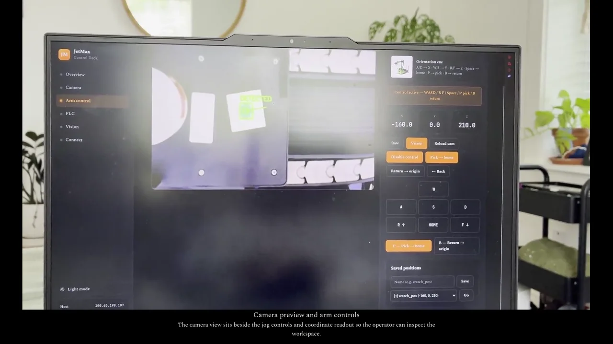

# JetMax control

Python tools and a browser control deck for a Hiwonder JetMax running on a Jetson Nano. The project combines ROS-based arm control, camera processing, and experiments with an Allen-Bradley Micro820 PLC.

[](https://trylen22.github.io/demos/jetmax/)

[Watch the captioned demonstration](https://trylen22.github.io/demos/jetmax/). The page also provides the MP4 and subtitle file.

The video is existing lab footage of the control dashboard and camera preview. It is not a new unattended robot run or a complete verification of every script in this repository.

## Hardware and software

- Hiwonder JetMax with its supplied Ubuntu 18.04 and ROS Melodic environment.
- Jetson Nano with the Hiwonder `jetmax_control` and `usb_cam` packages.
- Optional Micro820 and a configured lab Ethernet network.
- `pylogix` and `pymodbus` for the PLC experiments.

The base robot packages are maintained by [JetMaxRoboticArm](https://github.com/JetMaxRoboticArm). A generic laptop Python environment does not replace the robot's ROS installation.

## Start on a configured robot

```bash
git clone https://github.com/Trylen22/jetmax-control.git
cd jetmax-control
./run.sh dashboard
```

Open `http://<robot-address>:8888/` from the connected computer. `run.sh` sources `~/ros/devel/setup.bash` when it exists. Inspect `scripts/robot_setup.sh` before using it for initial configuration.

Use the confirmed address and an account configured for your robot:

```bash
ssh -i ~/.ssh/jetmax_key hiwonder@<robot-address>
```

## Commands

| Command | Purpose |
|---|---|
| `./run.sh dashboard` | Browser dashboard on port 8888 |
| `./run.sh stream` | Camera stream on port 8080 |
| `./run.sh vision-stream` | Annotated green detection on port 8081 |
| `./run.sh wasd` | Keyboard jogging |
| `./run.sh belt` | Vision-guided belt-pick experiment |
| `./run.sh belt-tcp` | Belt vision with PLC TCP communication |
| `./run.sh plc-read` | Read the configured PLC command tag |
| `./run.sh plc-live-sim` | PLC integration with simulated robot actions |
| `./run.sh modb` | Modbus inspection tools |

Movement commands require a supervised, configured robot workspace. Read each script and its device settings before running it. The simulated PLC mode does not validate physical motion or communication on another installation.

## Source map

| Directory | Contents |
|---|---|
| `scripts/arm/` | Jogging and arm-motion experiments |
| `scripts/vision/` | Image streams and belt detection |
| `scripts/plc/` | PLC and protocol experiments |
| `scripts/web/` | Dashboard server |
| `lib/` | Shared helpers |
| `docs/` | Setup notes and command references |
| `assets/` | Dashboard and reference pages |

Start with [setup](docs/SETUP.md), [commands](docs/COMMANDS.md), and the [boot sequence](docs/BOOT_SEQUENCE.md). Older lab notes contain installation-specific network examples; replace them with confirmed settings for your station. Keep local poses, credentials, and recordings out of source control.
